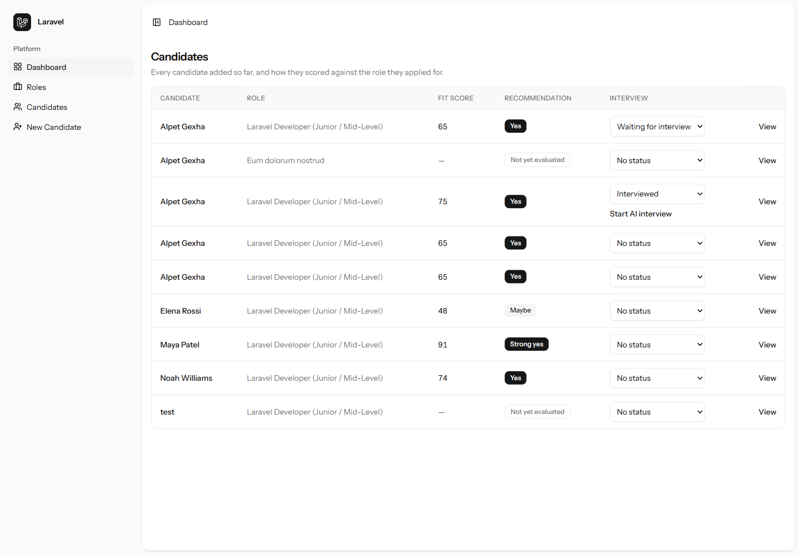
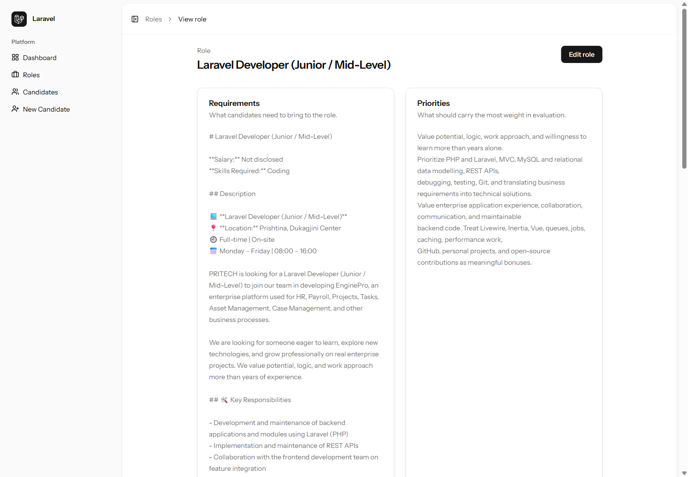
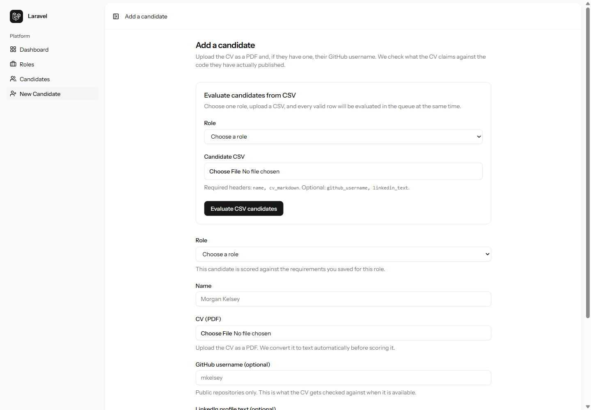
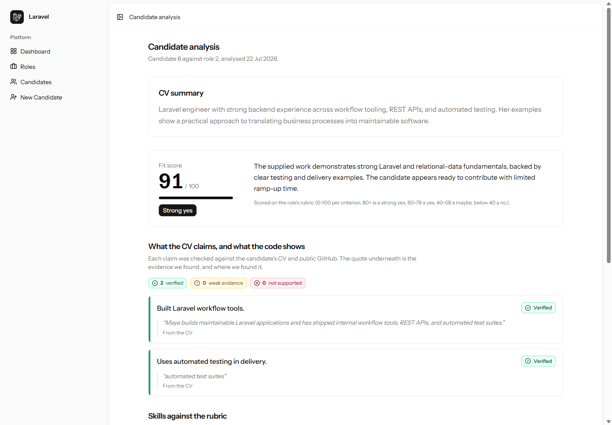
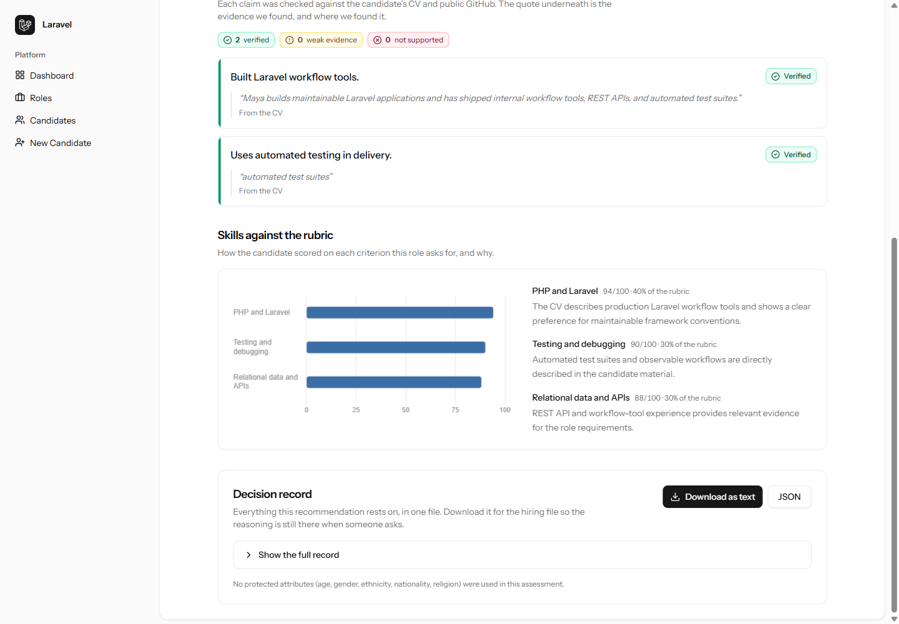
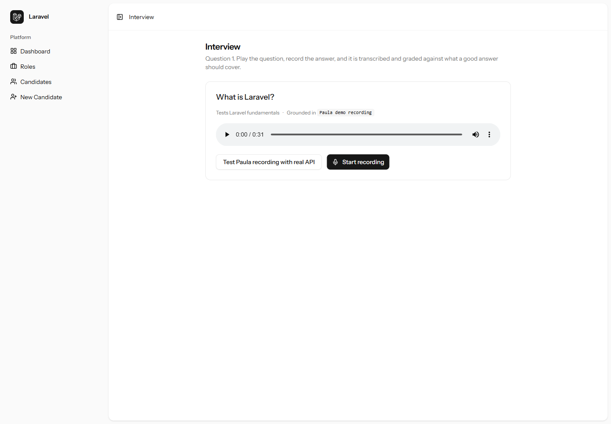

# HrHire

HrHire is an evidence-first, artificial intelligence (AI)-assisted workspace for evaluating software candidates against a specific role. It turns a job description, curriculum vitae (CV), public GitHub work, and a structured interview into a reviewable decision record.

The project is built for hiring teams that want faster screening without reducing a candidate to keywords. Every score is tied to the role, every claim is labelled by the strength of its evidence, and every recommendation remains available for human review.



## Vision

Hiring software engineers should be consistent, explainable, and grounded in work a candidate can demonstrate. HrHire helps teams find relevant evidence while keeping people responsible for the final decision.

## Goal

HrHire aims to bring the complete early-stage technical hiring workflow into one place:

1. Define what success looks like for a role.
2. Add one candidate or import a group.
3. Compare each candidate with the same role-specific rubric.
4. Verify CV claims against the material provided and public GitHub evidence.
5. Turn uncertain or weakly supported areas into focused interview questions.
6. Record, transcribe, and grade answers against explicit answer criteria.
7. Preserve the reasoning as a decision record that a hiring team can revisit.

## What HrHire offers

HrHire connects role definition, candidate intake, evaluation, and interviewing in one workflow.

### Role-based evaluation

Create and edit roles with separate requirements and hiring priorities. HrHire uses these fields to build the scoring rubric, so candidates are evaluated for the role they applied for rather than against a generic profile.



### Flexible candidate intake

Add candidates individually or evaluate a larger group through the same role-specific process:

- Upload a CV as a Portable Document Format (PDF) file and preview AI-extracted profile fields before saving.
- Add a candidate’s name, CV text, GitHub username, and supplied LinkedIn information.
- Import candidates from a comma-separated values (CSV) file for queued batch evaluation.
- Track valid and invalid import rows and show row-specific validation errors.
- Keep GitHub and LinkedIn details optional when they are unavailable.



### Evidence-backed AI analysis

HrHire produces a structured evaluation for each candidate:

- A concise CV summary.
- A 0–100 fit score and matching recommendation.
- A role-weighted score for every important skill.
- Clear reasoning for each score.
- Candidate claims marked as verified, weak, or unsupported.
- Exact evidence quotes and source references when available.
- Interview questions that target the weakest or least-verified areas.

When a GitHub username is supplied, HrHire reads the public profile, ranks the candidate’s repositories, and inspects relevant source files. HrHire caches GitHub responses locally to reduce repeated application programming interface (API) requests.



### Transparent scoring and decision records

The analysis view explains how every skill performed against the role’s rubric. Hiring teams can inspect the full record and download it as text or JavaScript Object Notation (JSON).

Analyses are cached by the candidate and role inputs. Reopening an unchanged evaluation uses the stored result instead of making another AI request.



### Candidate pipeline

The dashboard gives the team one view of:

- Every candidate and their target role.
- Evaluation progress and completed fit scores.
- Strong yes, yes, maybe, and no recommendations.
- Interview status, including waiting for interview and interviewed.
- Direct access to the candidate’s detailed analysis.

### AI-assisted voice interviews

HrHire turns analysis-generated questions into a structured interview:

- Generate spoken audio for each question.
- Record an answer in the browser.
- Transcribe the recorded response.
- Grade the answer against explicit ideal-answer points.
- Show a score and focused feedback after each answer.
- Save the completed interview report with the candidate.



### Responsible evaluation

The analyzer is instructed to judge demonstrated skills and role-related evidence only. It does not use age, gender, ethnicity, nationality, religion, marital status, photographs, or names as signals of ability.

HrHire supports a hiring decision; it does not make the final decision. A person should review the evidence, account for missing context, and give candidates an appropriate way to correct inaccurate information.

## How it works

```text
Role requirements and priorities
              |
              v
CV + optional LinkedIn text + public GitHub evidence
              |
              v
Structured candidate analysis
  |           |             |
  v           v             v
Fit score   Claim checks   Skill rubric
              |
              v
Grounded interview questions
              |
              v
Audio question -> recorded answer -> transcription -> grading
              |
              v
Reviewable hiring decision record
```

Candidate evaluations and CSV imports run through Laravel’s queue system. The AI agents use strict structured output. The server adds timestamps, rubric details, and the fairness statement.

## Technology

- PHP 8.3 and Laravel 13
- Laravel AI with structured OpenAI agents
- Inertia.js 3, React 19, and TypeScript
- Tailwind CSS 4 and Radix UI
- Laravel Wayfinder for typed routes
- Chart.js for rubric visualisation
- SQLite by default
- Laravel queues and job batches
- PHPUnit 12 and Larastan

## Local setup

### Requirements

- PHP 8.3 or later
- Composer
- Node.js and npm
- An AI provider configured for Laravel AI

### Install

```bash
git clone your_repository_url_here
cd HrHire
composer setup
```

Configure the AI provider credentials in `.env`, then start the application:

```bash
composer run dev
```

In another terminal, start the worker used for candidate evaluation and CSV imports:

```bash
php artisan queue:work
```

The default setup uses SQLite and the database queue connection.

### Demo data

The demo seeder creates a Laravel role and a range of evaluated candidate outcomes:

```bash
php artisan db:seed --class=DemoSeeder
```

The seeder can make a live AI request and read public GitHub data. Configure the required credentials and review provider usage before running it.

## Quality checks

Run the application test suite:

```bash
php artisan test --compact
```

Run the complete CI check, including PHP formatting, static analysis, frontend linting, formatting, type checks, and tests:

```bash
composer ci:check
```

## License

HrHire is open-source software licensed under the [MIT license](https://opensource.org/licenses/MIT).
